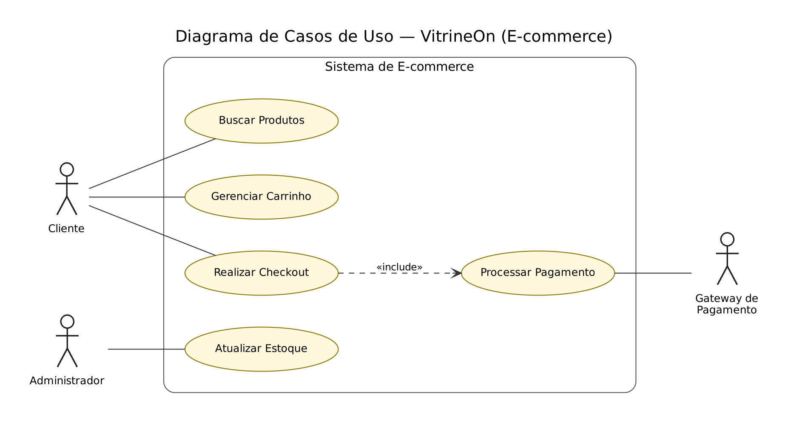
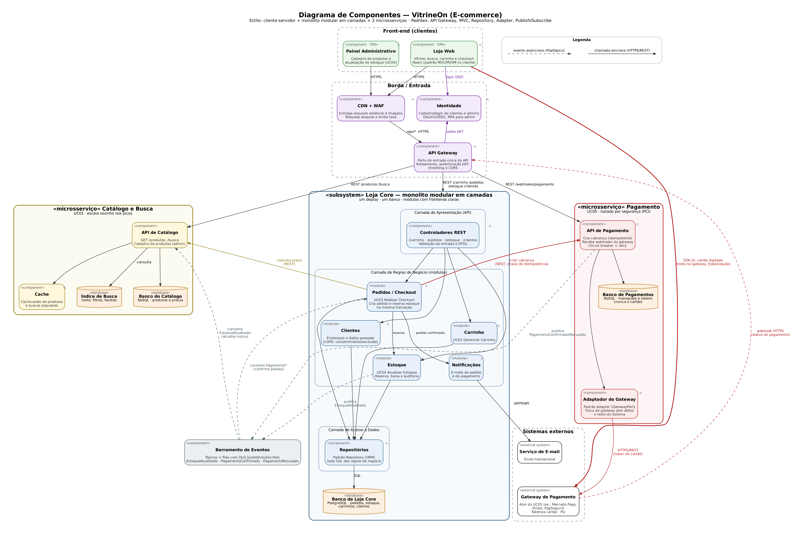
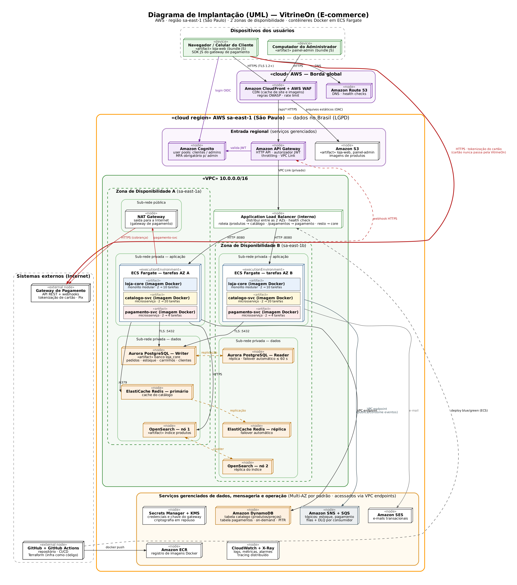

# VitrineOn — Documento de Arquitetura de Software (E-commerce)

> Projeto final da disciplina de **Arquitetura de Software**: documentação arquitetural completa de uma plataforma de e-commerce, partindo do **Diagrama de Casos de Uso** feito na atividade anterior.
> Entrega **100% conceitual**, sem código.

| | |
|---|---|
| **Aluno** | Lucas Borges Krziminski |
| **Modalidade** | Individual |
| **Sistema** | E-commerce (estudo de caso da Semana 14: picos em promoções, catálogo grande, estoque e pagamento que precisam bater) |
| **Versão** | 1.0 |

## Sumário

1. [Estrutura do repositório](#estrutura-do-repositório)
2. [Parte 1 — Análise do cenário e requisitos](#parte-1--análise-do-cenário-e-requisitos)
3. [Parte 2 — Documentação arquitetural](#parte-2--documentação-arquitetural)
   - [2.1 Estilo arquitetural escolhido e por quê](#21-estilo-arquitetural-escolhido-e-por-quê)
   - [2.2 Diagrama de Componentes](#22-diagrama-de-componentes)
   - [2.3 Diagrama de Implantação](#23-diagrama-de-implantação)
   - [2.4 Consistência: componente → nó de implantação](#24-consistência-componente--nó-de-implantação)
   - [2.5 Como a arquitetura atende cada atributo de qualidade](#25-como-a-arquitetura-atende-cada-atributo-de-qualidade)
   - [2.6 Riscos e evolução](#26-riscos-e-evolução)
4. [Parte 3 — Apresentação e Peer Review](#parte-3--apresentação-e-peer-review)
5. [Parte 4 — Reflexão](#parte-4--reflexão)
6. [Referências](#referências)

---

## Estrutura do repositório

```
/
├── README.md                          ← este documento (amarra todas as decisões)
├── docs/
│   ├── 01-cenario.md                  ← descrição textual do sistema, atores, premissas e restrições
│   ├── 02-requisitos-e-atributos-de-qualidade.md   ← RNFs mensuráveis, priorização ISO 25010, cenários de qualidade
│   ├── 03-decisoes-arquiteturais.md   ← registros de decisão (ADRs)
│   ├── 04-rubrica-peer-review.md      ← rubrica para avaliar os outros grupos
│   └── 05-roteiro-do-pitch.md         ← roteiro da apresentação de 10–15 min
├── diagramas/
│   ├── 01-casos-de-uso.png            ← diagrama da atividade anterior (base do projeto)
│   ├── 02-componentes.png
│   ├── 03-implantacao.png
│   └── fontes/                        ← código-fonte editável dos diagramas (Graphviz .dot)
└── apresentacao/
    ├── pitch-vitrineon.pdf            ← slides do pitch
    └── fonte/                         ← fonte HTML dos slides
```

---

## Parte 1 — Análise do cenário e requisitos

### 1.1 O sistema em uma frase

A **VitrineOn** é a loja virtual de uma varejista de médio porte, onde o **cliente** busca produtos, monta um carrinho e paga com cartão ou Pix por um **gateway de pagamento externo**, e o **administrador** mantém o estoque. Detalhes completos: [`docs/01-cenario.md`](docs/01-cenario.md).

<p align="center"></p>

### 1.2 Restrições que moldam a arquitetura

| Restrição | Consequência |
|---|---|
| **Equipe pequena** (6 pessoas) e **prazo de 6 meses** | Nada de 15 microsserviços nem de operar Kubernetes. Poucos deploys, serviços gerenciados |
| **Orçamento limitado** (~US$ 3 mil/mês fora de pico) | Pagar por uso e escalar só nos picos |
| **Picos de 10×** na Black Friday | A parte mais acessada (busca) precisa escalar sozinha |
| **Pagamento com cartão** (PCI-DSS) e **LGPD** | Cartão nunca passa pelos nossos servidores; dados hospedados no Brasil |
| **Estoque e pagamento precisam bater** | Reserva de estoque e pedido em uma transação única |

### 1.3 Requisitos não-funcionais principais

A lista completa (21 RNFs, todos com métrica) está em [`docs/02-requisitos-e-atributos-de-qualidade.md`](docs/02-requisitos-e-atributos-de-qualidade.md). Os que mais pesaram nas decisões foram estes:

| ID | Requisito | Métrica |
|---|---|---|
| RNF01 | Dados de cartão nunca tocam nossos servidores | escopo PCI **SAQ A**; 0 dados de cartão em logs/bancos |
| RNF05 | Disponibilidade | **≥ 99,9%/mês** |
| RNF07 | Sem cobrança duplicada nem pedido pago perdido | idempotência + filas com DLQ; **0 duplicidades** |
| RNF09 | Tempo de resposta da busca | **p95 ≤ 200 ms** com 20 mil usuários simultâneos |
| RNF11 | Confirmação do checkout (sem o gateway) | **p95 ≤ 1,5 s** |
| RNF13 | Escalar para 10× o tráfego | de 2 até 20 tarefas em **≤ 3 min**, automático |
| RNF15 | Deploy sem parar a loja | deploy independente das 3 unidades, blue/green |
| RNF18 | Trocar de gateway de pagamento | só o Serviço de Pagamento muda |

### 1.4 Atributos de qualidade priorizados (ISO/IEC 25010)

| # | Atributo | Por que nessa posição |
|---|---|---|
| **1** | **Segurança** | Lida com **dados de cartão de crédito** e dados pessoais (CPF, endereço). Um vazamento pode tirar da empresa o direito de aceitar cartão e gerar multa da LGPD. É o único atributo cuja falha pode **inviabilizar o negócio**. |
| **2** | **Confiabilidade** | Cada minuto fora do ar na Black Friday é venda perdida, e **cobrar duas vezes** ou **perder um pedido pago** gera chargeback e Procon. |
| **3** | **Eficiência de desempenho** (inclui escalabilidade) | Busca lenta derruba conversão, e o sistema precisa aguentar 10× nos picos sem pagar essa capacidade o ano todo. |
| **4** | **Manutenibilidade** | 6 pessoas precisam evoluir o produto com segurança: módulos claros, deploy independente, observabilidade. |
| **5** | **Usabilidade** | Checkout em até 3 etapas e mobile-first. É importante, mas se resolve mais no front-end. |
| **6** | **Portabilidade / Compatibilidade** | Contêineres Docker e infraestrutura como código, mais uma integração padrão REST com o gateway. |

> **Trade-off central:** quando Segurança e Disponibilidade conflitam, **Segurança vence**. Uma loja fora do ar perde vendas por horas; uma loja que vaza cartões pode fechar.

---

## Parte 2 — Documentação arquitetural

### 2.1 Estilo arquitetural escolhido e por quê

Seguindo a aula de Estilos e Padrões ("não existe estilo perfeito, existe o mais adequado ao contexto"), a VitrineOn **combina estilos**:

| Estilo / Padrão | Onde aparece | Motivo (requisito atendido) |
|---|---|---|
| **Cliente-servidor** | Loja Web e Painel Admin (clientes) → API única no servidor | Vários tipos de cliente usam a mesma API; regras e segurança centralizadas no servidor |
| **Monolito modular em camadas** | **Loja Core**: Carrinho, Pedidos/Checkout, Estoque, Clientes, Notificações | Equipe pequena, prazo curto e **consistência**: reserva de estoque e pedido na **mesma transação ACID** |
| **Microsserviços (só 2)** | **Catálogo e Busca** · **Pagamento** | Catálogo: é o que recebe 95% do tráfego e **precisa escalar sozinho**. Pagamento: **isolamento de segurança** (PCI) e possibilidade de trocar o gateway |
| **API Gateway** (padrão) | Porta de entrada única | Roteamento, autenticação JWT e limite de taxa em um só lugar; os clientes não conhecem os serviços internos |
| **Repository** (padrão) | Camada de acesso a dados da Loja Core | Isola o SQL das regras de negócio; facilita testes |
| **MVC** (padrão) | Front-ends (SPA) | Separa telas, estado e controle no cliente |
| **Adapter** (padrão) | Serviço de Pagamento → gateway | Trocar Mercado Pago por Stripe, por exemplo, sem tocar no checkout (RNF18) |
| **Publish/Subscribe com filas** | Eventos `EstoqueAtualizado` e `PagamentoConfirmado` | Desacopla serviços; se um consumidor cair, a mensagem espera na fila (RNF07) |

#### Alternativas consideradas

| Critério (peso) | A) Monolito em camadas puro | B) Microsserviços completos (6–8 serviços) | **C) Monolito modular + 2 microsserviços (escolhida)** |
|---|---|---|---|
| Segurança (5) | Pagamento divide processo e credenciais com todo o resto | Bom isolamento | **Pagamento isolado** com rede, credenciais e banco próprios |
| Confiabilidade (4) | Uma falha pode derrubar tudo | Falhas isoladas, mas **consistência difícil** (sagas entre estoque e pedido) | Falha do gateway/busca não derruba o checkout; **estoque e pedido em transação única** |
| Desempenho/escala (4) | Escala o sistema inteiro para aguentar a busca (caro) | Escala por serviço | **Escala a busca sozinha** (2 → 20 tarefas) |
| Manutenibilidade (3) | Simples no início, tende a virar bagunça | Operação e monitoramento complexos para 6 pessoas | **3 unidades de deploy**, módulos com fronteiras claras |
| Custo inicial | Baixo | Alto | Médio-baixo |

Isso segue a regra prática da aula: **"comece simples e só complique quando houver um motivo real"**. Só viraram microsserviços as duas partes que têm um motivo real: **escala** (Catálogo) e **segurança** (Pagamento). Se o negócio crescer, os módulos da Loja Core já têm fronteiras para serem extraídos depois (ver [2.6](#26-riscos-e-evolução)).

Decisões registradas formalmente em [`docs/03-decisoes-arquiteturais.md`](docs/03-decisoes-arquiteturais.md) (ADRs).

### 2.2 Diagrama de Componentes



#### Responsabilidades

| Componente | Tipo | Responsabilidade | Caso de uso |
|---|---|---|---|
| **Loja Web** | SPA | Vitrine, busca, carrinho, checkout; carrega o SDK do gateway para digitar o cartão | UC01–03 |
| **Painel Administrativo** | SPA | Cadastro de produtos e atualização de estoque | UC04 |
| **CDN + WAF** | Borda | Entrega arquivos estáticos e imagens; bloqueia ataques (OWASP Top 10) e limita taxa | — |
| **API Gateway** | Borda | Porta de entrada única; valida JWT; roteia para Loja Core, Catálogo ou Pagamento; throttling | — |
| **Identidade** | Borda | Cadastro e login (OAuth2/OIDC); MFA obrigatório para administradores | — |
| **Loja Core: Controladores REST** | Camada de apresentação | Endpoints `/carrinho`, `/pedidos`, `/estoque`, `/clientes`; validação de entrada | — |
| **Módulo Carrinho** | Camada de negócio | Adicionar, remover e alterar itens; carrinho persistente | UC02 |
| **Módulo Pedidos/Checkout** | Camada de negócio | Valida preço (Catálogo), **reserva estoque e cria o pedido numa transação**, solicita cobrança | UC03 |
| **Módulo Estoque** | Camada de negócio | Reserva, baixa, liberação (reserva expira em 15 min), auditoria; publica `EstoqueAtualizado` | UC04 |
| **Módulo Clientes** | Camada de negócio | Dados pessoais e endereços; consentimento e exclusão (LGPD) | — |
| **Módulo Notificações** | Camada de negócio | E-mails de confirmação de pedido e de pagamento | — |
| **Repositórios** | Camada de acesso a dados | Padrão Repository; único ponto que fala SQL | — |
| **Banco da Loja Core** | Dados | PostgreSQL: pedidos, itens, estoque, carrinhos, clientes | — |
| **API de Catálogo** | Microsserviço | Consulta e busca de produtos; cadastro (admin); consome `EstoqueAtualizado` para atualizar disponibilidade | UC01 |
| **Cache / Índice de Busca / Banco do Catálogo** | Dados do Catálogo | Redis (cache-aside), OpenSearch (texto, filtros, facetas), DynamoDB (produtos e preços) | UC01 |
| **API de Pagamento** | Microsserviço | Cria cobrança com **chave de idempotência**; recebe webhooks; circuit breaker; publica `PagamentoConfirmado/Recusado` | UC05 |
| **Adaptador do Gateway** | Microsserviço | Interface `GatewayPort` + implementação do gateway atual | UC05 |
| **Banco de Pagamentos** | Dados | DynamoDB: transações, status e **token** do gateway (nunca o cartão) | UC05 |
| **Barramento de Eventos** | Mensageria | Tópicos + filas com DLQ e reentrega | — |
| **Gateway de Pagamento** | Sistema externo | Ator do UC05: tokeniza cartão, autoriza, envia webhook | UC05 |
| **Serviço de E-mail** | Sistema externo | Envio transacional | — |

#### Como os componentes se comunicam

| De → Para | Tipo | Protocolo / contrato |
|---|---|---|
| Front-ends → CDN → API Gateway | Síncrono | HTTPS, REST/JSON, token JWT no header |
| API Gateway → Loja Core / Catálogo / Pagamento | Síncrono | REST via rede privada |
| Pedidos → Catálogo | Síncrono | `GET /produtos/{id}` (confere preço no checkout) |
| Pedidos → Pagamento | Síncrono | `POST /cobrancas` com header `Idempotency-Key: {pedidoId}` |
| Loja Web → Gateway externo | Síncrono | SDK JavaScript do gateway; o cartão vai **direto** ao gateway e volta só um **token** |
| Gateway externo → Pagamento | Assíncrono | **Webhook** HTTPS assinado (HMAC), via API Gateway |
| Estoque → Catálogo | Assíncrono | Evento `EstoqueAtualizado` (tópico + fila) |
| Pagamento → Pedidos | Assíncrono | Eventos `PagamentoConfirmado` / `PagamentoRecusado` |

#### Fluxo do checkout (UC03 `<<include>>` UC05)

1. O cliente clica em **Finalizar compra**. A Loja Web envia `POST /pedidos` pelo API Gateway, que valida o JWT.
2. O **Módulo Pedidos** confere os preços no Catálogo e, **numa única transação** no banco da Loja Core, **cria o pedido** (status `AGUARDANDO_PAGAMENTO`) e **reserva o estoque**. Se faltar estoque, nada é gravado.
3. O cliente digita o cartão nos **campos hospedados pelo gateway** (iframe carregado pelo SDK). O gateway devolve um **token**.
4. Pedidos chama `POST /cobrancas` no **Serviço de Pagamento** com o token e a chave de idempotência = id do pedido. Se a chamada for repetida, a cobrança **não duplica**.
5. O Pagamento, pelo **Adaptador**, solicita a autorização ao gateway e responde "em processamento".
6. O gateway envia um **webhook** com o resultado. O Pagamento valida a assinatura e publica `PagamentoConfirmado` (ou `Recusado`) no barramento.
7. A Loja Core consome o evento, **confirma o pedido e baixa o estoque** (ou libera a reserva) e o módulo Notificações envia o e-mail.
8. Se o gateway estiver fora, o **circuit breaker** abre, o cliente vê uma mensagem amigável e a reserva expira sozinha em 15 min (RNF08). Busca e carrinho continuam funcionando.

### 2.3 Diagrama de Implantação



**Decisões de infraestrutura:**

| Decisão | Justificativa (RNF) |
|---|---|
| **AWS, região sa-east-1 (São Paulo)** | Latência baixa para clientes no Brasil (RNF12) e dados no país (LGPD, RNF21) |
| **2 zonas de disponibilidade** em tudo que é crítico | A queda de uma AZ não derruba a loja (RNF05, RNF06) |
| **ECS Fargate** (contêineres Docker sem gerenciar servidores) em vez de Kubernetes (EKS) | Equipe pequena: sem cluster para operar. Autoescalonamento por CPU e por requisições (RNF13) |
| **CloudFront + WAF** na borda | Cache de site e imagens perto do cliente; proteção contra ataques e bots (RNF12, RNF02) |
| **Amazon API Gateway + VPC Link + ALB interno** | Os serviços ficam em **sub-redes privadas**, sem IP público |
| **Aurora PostgreSQL Multi-AZ** (writer + reader) para a Loja Core | Transações ACID para estoque e pedidos; failover ≤ 60 s; backup contínuo (RPO ≤ 5 min) |
| **DynamoDB on-demand** para Catálogo e Pagamentos | Paga por requisição e escala sozinho no pico; cada microsserviço tem **seu próprio banco** |
| **OpenSearch (2 nós) + ElastiCache Redis** | Busca textual com p95 ≤ 200 ms (RNF09); cache para os produtos mais vistos |
| **SNS + SQS com DLQ** | Eventos não se perdem se um consumidor estiver fora (RNF07) |
| **NAT Gateway único** | Só o Serviço de Pagamento precisa sair para a Internet. Um NAT só economiza custo (trade-off aceito: se a AZ A cair, os pagamentos param até o NAT ser recriado; mitigação: 2º NAT nas semanas de pico) |
| **Secrets Manager + KMS** | Nenhuma senha ou chave de API no código; criptografia em repouso (RNF02) |
| **CloudWatch + X-Ray** | Logs centralizados, métricas, alarmes e tracing distribuído (RNF17) |
| **GitHub Actions → ECR → ECS (blue/green)** e **Terraform** | Deploy independente sem downtime (RNF15); infra reproduzível (RNF20) |

**Capacidade e escalonamento:**

| Unidade de deploy | Mínimo (dia comum) | Máximo (pico) | Gatilho de escala |
|---|---|---|---|
| `loja-core` | 2 tarefas (1 por AZ) | 10 | CPU > 60% ou > 500 req/min por tarefa |
| `catalogo-svc` | 2 | 20 | CPU > 50% ou latência p95 > 150 ms |
| `pagamento-svc` | 2 | 4 | CPU > 60% |

Nas semanas de Black Friday, o mínimo é elevado com antecedência (escalonamento agendado) para não depender só da reação automática.

### 2.4 Consistência: componente → nó de implantação

Cada componente do diagrama de componentes aparece em um nó do diagrama de implantação:

| Componente (Diagrama de Componentes) | Artefato | Nó (Diagrama de Implantação) |
|---|---|---|
| Loja Web, Painel Administrativo | `loja-web`, `painel-admin` (bundles JS) | Amazon S3 → entregue pelo CloudFront → executa no **dispositivo do usuário** |
| CDN + WAF | — | Amazon CloudFront + AWS WAF |
| API Gateway | — | Amazon API Gateway |
| Identidade | — | Amazon Cognito |
| Loja Core (controladores, módulos, repositórios) | `loja-core` (imagem Docker) | ECS Fargate, tarefas nas AZs A e B |
| Banco da Loja Core | banco `loja_core` | Aurora PostgreSQL Writer (AZ A) + Reader (AZ B) |
| API de Catálogo | `catalogo-svc` (imagem Docker) | ECS Fargate, AZs A e B |
| Cache | — | ElastiCache Redis primário + réplica |
| Índice de Busca | índice `produtos` | OpenSearch, 2 nós |
| Banco do Catálogo | tabela `catalogo` | DynamoDB |
| API de Pagamento + Adaptador do Gateway | `pagamento-svc` (imagem Docker) | ECS Fargate, AZs A e B, saída pelo NAT Gateway |
| Banco de Pagamentos | tabela `pagamentos` | DynamoDB |
| Barramento de Eventos | tópicos e filas | Amazon SNS + SQS |
| Serviço de E-mail | — | Amazon SES |
| Gateway de Pagamento | — | Nó externo (Internet) |

### 2.5 Como a arquitetura atende cada atributo de qualidade

| Atributo | Táticas arquiteturais aplicadas |
|---|---|
| **1. Segurança** | Tokenização no navegador (cartão nunca chega ao servidor, PCI SAQ A) · serviço de Pagamento isolado (rede, IAM e banco próprios) · WAF + rate limit · JWT validado no API Gateway · MFA para admin · TLS em tudo · KMS + Secrets Manager · sub-redes privadas · log de auditoria de estoque e pedidos · dados no Brasil |
| **2. Confiabilidade** | Multi-AZ (tarefas, Aurora, Redis, OpenSearch) · health checks no ALB · **transação única** reserva+pedido · **idempotência** na cobrança · filas com reentrega e DLQ · circuit breaker e timeout no gateway · reserva com expiração · deploy blue/green com rollback automático |
| **3. Desempenho / escalabilidade** | CDN para estáticos e imagens · busca no OpenSearch + cache Redis · **Catálogo escala independente** (2 → 20) · serviços sem estado (escala horizontal) · DynamoDB on-demand · réplica de leitura no Aurora · escalonamento agendado para datas de pico |
| **4. Manutenibilidade** | Monolito **modular** (fronteiras por caso de uso) · camadas + Repository · Adapter no gateway · 3 deploys independentes · CI/CD com testes · logs, métricas e tracing centralizados |
| **5. Usabilidade** | SPA responsiva, checkout em 3 etapas, carrinho persistente entre dispositivos, componente de pagamento nativo do gateway (Pix e cartão) |
| **6. Portabilidade** | Docker (roda igual em qualquer ambiente) · Terraform · PostgreSQL padrão · integração REST com o gateway |

### 2.6 Riscos e evolução

| Risco | Probabilidade / Impacto | Mitigação |
|---|---|---|
| Gateway de pagamento instável na Black Friday | Média / Alto | Circuit breaker; reserva com expiração; Adapter permite um 2º gateway de contingência |
| Aurora writer vira gargalo de escrita no pico | Baixa / Alto | 15 mil pedidos/dia ≈ 0,2 escrita/s em média (picos de dezenas/s), bem dentro da capacidade; teste de carga antes da data; leitura vai para a réplica |
| Monolito crescer sem disciplina e virar "bola de lama" | Média / Médio | Regras de dependência entre módulos verificadas no CI; cada módulo com seu schema |
| Custo da AWS ultrapassar o orçamento | Média / Médio | Alarmes de custo (AWS Budgets); escalar para baixo fora do pico; instâncias reservadas para Aurora |
| Dependência de um único provedor (lock-in) | Alta / Baixo | Docker, PostgreSQL e Terraform reduzem o custo de migração |

**Evolução prevista:** se o negócio crescer (marketplace, app nativo, várias equipes), os módulos **Pedidos** e **Estoque** podem ser extraídos do monolito, aplicando o padrão *Strangler Fig*. As fronteiras dos módulos e os eventos já existentes preparam essa transição.

---

## Parte 3 — Apresentação e Peer Review

| Entregável | Arquivo |
|---|---|
| Slides do pitch (10–15 min) | [`apresentacao/pitch-vitrineon.pdf`](apresentacao/pitch-vitrineon.pdf) |
| Roteiro de fala com tempo por slide | [`docs/05-roteiro-do-pitch.md`](docs/05-roteiro-do-pitch.md) |
| Rubrica de avaliação dos outros grupos | [`docs/04-rubrica-peer-review.md`](docs/04-rubrica-peer-review.md) |

---

## Parte 4 — Reflexão

### Qual a importância do Diagrama de Implantação para a equipe de infraestrutura/DevOps?

O Diagrama de Componentes responde **o que** o sistema faz e como suas partes conversam. O Diagrama de Implantação responde **onde** e **como** isso roda no mundo físico ou na nuvem. Para a equipe de infraestrutura/DevOps, ele é a tradução do software em coisas que precisam ser provisionadas, configuradas, protegidas e pagas:

- **É o "mapa da obra".** Mostra quais servidores, contêineres, bancos, balanceadores, CDNs e redes precisam existir. No nosso caso, por exemplo: 3 imagens Docker no ECS Fargate em 2 zonas, um Aurora com writer e reader, um NAT Gateway. Daqui sai diretamente o código Terraform.
- **Torna visíveis os requisitos não-funcionais.** Disponibilidade aparece como "duas AZs e réplica de banco". Segurança aparece como "sub-rede privada, WAF, NAT só para o pagamento". Escalabilidade aparece como "2 → 20 tarefas". O DevOps consegue verificar se a infraestrutura realmente cumpre o que o documento promete.
- **Mostra os caminhos de comunicação e protocolos** (portas 5432, 6379, HTTPS, VPC endpoints). Isso vira regras de firewall e security groups.
- **Revela pontos únicos de falha e custos**, como o nosso NAT Gateway único, decisão consciente que o diagrama deixa explícita.
- **Apoia operação e incidentes.** Quando algo cai às 3h da manhã, o diagrama diz o que depende do quê.

Sem ele, cada pessoa imagina uma infraestrutura diferente, e a arquitetura fica só no papel.

### Por que o Peer Review é uma ferramenta poderosa de aprendizado em arquitetura de software?

- **Desenvolve senso crítico.** Avaliar o trabalho de um colega obriga a perguntar "por quê?" a cada decisão, e a mesma pergunta passa a ser feita ao próprio projeto.
- **Expõe a diferentes contextos.** Cada colega trabalhou com um sistema diferente (streaming, banco, jogo). Ver como outros resolveram problemas parecidos ajuda a **reconhecer padrões e anti-padrões**: um API Gateway bem usado, um banco compartilhado que acopla microsserviços, um diagrama de implantação que não "conversa" com o de componentes.
- **Reforça que não existe arquitetura perfeita**, só trade-offs. Duas soluções diferentes podem estar corretas para contextos diferentes, e o revisor aprende a julgar pela **justificativa**, não pelo gosto.
- **Treina a comunicação técnica.** Dar feedback útil ("a escolha X atende ao requisito Y, porém Z gera acoplamento") exige usar o vocabulário da disciplina com precisão, como numa revisão de arquitetura real (ARB) ou num code review.
- **Simula o mercado.** Arquitetos passam boa parte do tempo revisando propostas de terceiros e defendendo as próprias. Receber críticas também ensina a separar a ideia do ego.

---

## Referências

- BASS, L.; CLEMENTS, P.; KAZMAN, R. **Software Architecture in Practice**. 4. ed. Addison-Wesley, 2021. (atributos de qualidade, cenários e táticas)
- RICHARDS, M.; FORD, N. **Fundamentals of Software Architecture**. O'Reilly, 2020. (estilos e trade-offs)
- NEWMAN, S. **Building Microservices**. 2. ed. O'Reilly, 2021. (quando extrair serviços; Strangler Fig)
- KLEPPMANN, M. **Designing Data-Intensive Applications**. O'Reilly, 2017. (consistência e idempotência)
- ISO/IEC 25010:2011 e 25010:2023. **Systems and software Quality Requirements and Evaluation (SQuaRE): Product quality model**.
- PCI Security Standards Council. **PCI DSS v4.0** (SAQ A: comerciantes que terceirizam totalmente a captura do cartão).
- Material da disciplina: *Aula 2: Estilos e Padrões Arquiteturais* (Semana 14).
